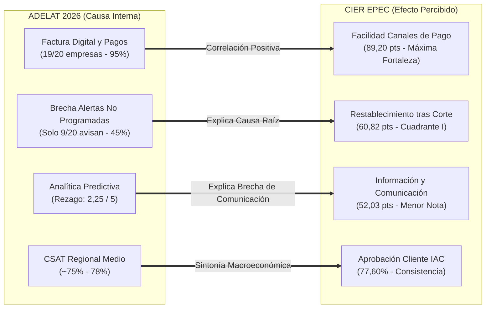

# ⚡ Benchmarking de Canales de Atención y Satisfacción: ADELAT 2026 (Parte II) vs. Encuesta CIER EPEC-AR

**Repositorio Oficial**: [https://github.com/protelemepec-coder/adelat-cier-benchmarking](https://github.com/protelemepec-coder/adelat-cier-benchmarking)  
**Organización / Autor**: `protelemepec-coder` & Agente [02] Ciencia de Datos & BI EPEC  
**Fecha de Creación**: 2026-10-09  
**Estado**: Activo / Fase de Documentación y Análisis Comparativo  

---

## 📌 1. Propósito y Alcance del Repositorio

Este repositorio reúne el **estudio comparativo integral, análisis de correlación empírica y puente metodológico de doble lazo** entre los dos principales estándares de evaluación de servicios en el sector de distribución eléctrica de América Latina:

1. **Benchmarking de Canales de Atención 2026 (Parte II) - ADELAT**:
   - Evaluación de **Madurez Operativa (*In-Out*)** de 20 distribuidoras en 9 países sobre 28 preguntas organizadas en 2 ejes (Gestión de PQR & Medición; Tecnología, Automatización y Analítica).
2. **Encuesta de Satisfacción de Clientes Residenciales CIER (2025-2026) - EPEC-AR**:
   - Auditoría de **Percepción de Calidad (*Out-In / Voice of Customer*)** sobre $N = 1.250$ encuestas residenciales domiciliarias ($\pm 3.92\%$ error muestral) con matriz IPA de 4 cuadrantes.

---

## 🧭 2. Arquitectura de Documentación y Archivos

```
adelat-cier-benchmarking/
├── README.md                                  # Ficha ejecutiva principal
├── data/
│   ├── raw/
│   │   └── ADELAT_BM_Canales_Atencion_INFORME_REGIONAL.pdf # Documento original (17 páginas)
│   └── processed/
│       └── adelat_2026_metricas_clave.json    # Base estructurada JSON de las 28 preguntas
├── docs/
│   ├── 00-Indice-General.md                   # Mapa de navegación y lectura
│   ├── 01-Marco-Metodologico-Comparativo.md   # Comparativa Voice of Customer vs. Operational Maturity
│   ├── 02-Radiografia-Estadistica-ADELAT-2026.md # Desglose de preguntas, métricas operativas y ranking
│   ├── 03-Correlaciones-Causa-Efecto-CIER-EPEC.md # Cruce empírico de capacidades vs. satisfacción
│   ├── 04-Matriz-Similitudes-y-Diferencias.md # Cuadro comparativo multidimensional exhaustivo
│   └── 05-Conclusiones-y-Hoja-de-Ruta-EPEC.md  # Observaciones, conclusiones y roadmap para continuar
└── scripts/
    ├── parse_adelat_report.py                 # Extractor de datos y textos desde PDF
    └── export_benchmarking_json.py            # Generador de matrices y síntesis estructurada
```

---

## 📊 3. Resumen de Hallazgos y Correlaciones Clave



---

## 🏆 4. Indicadores Macroeconómicos del Estudio

| Indicador Macro | ADELAT 2026 (Panel Regional) | CIER EPEC-AR (2026) |
| :--- | :---: | :---: |
| **Muestra Auditada** | 20 Distribuidoras (9 Países) | $N = 1.250$ Encuestas Residenciales |
| **Índice Global / Satisfacción** | **$3,35 / 5$** (Madurez en Desarrollo) | **$65,96 / 100$** (`ISCAL` Calidad Percibida) |
| **Aprobación / Satisfacción General** | CSAT Medio: **$75\% - 78\%$** | `IAC`: **$77,60\%$** |
| **FCR (Resolución Primer Contacto)** | Mediana: **$75\%$** (Rango $40\%-95\%$) | Tiempos de Atención: $62,40	ext{ pts}$ |
| **Autogestión Digital de Contactos** | Mediana: **$52\%$** (Rango $5\%-95\%$) | Canales Digitales: Crecimiento $+11,99\%$ |
