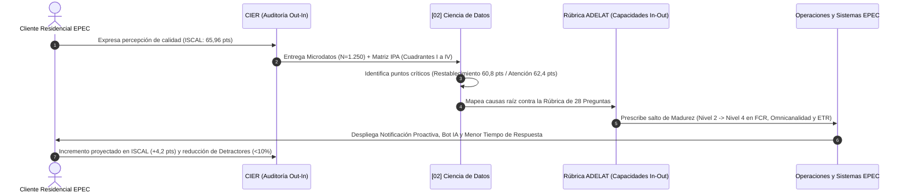

# 📐 Marco Metodológico Comparativo: Voice of Customer vs. Operational Maturity

**Fecha**: 2026-10-09  
**Agente**: [02] Ciencia de Datos & BI EPEC  

---

## 1. Los Dos Paradigmas de Evaluación en Distribución Eléctrica

La gestión de la experiencia del cliente y la calidad de servicio en empresas de distribución eléctrica requiere contrastar dos perspectivas complementarias:

### A. Paradigma Out-In: Voice of Customer (Modelo CIER)
- **Definición**: Evaluación directa del impacto vivencial que experimenta el cliente en su hogar.
- **Instrumento**: Encuestas representativas cara a cara y telefónicas sobre muestras probabilísticas de usuarios residenciales ($N=1.250$ en EPEC-AR).
- **Métrica Agregadora**: Índice de Satisfacción con la Calidad Percibida (`ISCAL`, escala $0-100$).
- **Mecanismo de Priorización**: **Matriz IPA de 4 Cuadrantes**, donde la Importancia Relativa ($X$) se deriva econométricamente mediante regresión multivariable, y el Desempeño ($Y$) refleja la nota media percibida.
- **Función Estratégica**: Indica con precisión matemática **QUÉ** atributos generan fricción y **DÓNDE** se concentran los detractores.

### B. Paradigma In-Out: Operational Maturity (Modelo ADELAT)
- **Definición**: Evaluación de las capacidades internas, arquitectura tecnológica, gobernanza y procesos que la distribuidora despliega para atender a sus clientes.
- **Instrumento**: Rúbrica técnica estandarizada de autodiagnóstico auditado entre pares en el Comité de Mercados ($20$ distribuidoras en $9$ países).
- **Métrica Agregadora**: Índice de Madurez Corporativo (escala discreta de $1$ a $5$, promedio simple de 28 preguntas).
- **Mecanismo de Priorización**: **Análisis de Brechas (*Gap Analysis*)** contra el cuartil superior ($Q3$) y las mejores prácticas del podio regional.
- **Función Estratégica**: Prescribe **CÓMO** y **CON QUÉ TECNOLOGÍA** cerrar las brechas identificadas.

---

## 2. El Modelo de Optimización de Doble Lazo (Two-Loop Optimization)

