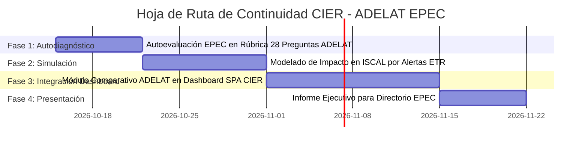

# 🎯 Conclusiones Estratégicas y Hoja de Ruta para EPEC

**Fecha**: 2026-10-09  
**Agente**: [02] Ciencia de Datos & BI EPEC  

---

## 📌 1. Conclusiones Principales

1. **Complementariedad Indiscutible**: CIER y ADELAT no compiten ni se duplican; forman los dos extremos de la cadena de valor de calidad. CIER audita el *resultado vivencial*, mientras que ADELAT audita la *maquinaria operativa*.
2. **Prioridad Número Uno para EPEC**: Resolver la brecha de alertas en fallas no programadas. La integración de SCADA/OMS con el módulo de notificaciones push/WhatsApp con cálculo de ETR (tiempo estimado de reposición) es la intervención con mayor retorno sobre el ISCAL.
3. **El Techo de la Autogestión**: EPEC debe pasar de chatbots estructurados basados en menú numérico hacia agentes de IA generativa con capacidad transaccional (reprogramar turnos, consultar reclamos técnicos, emitir libre deuda).
4. **Estandarización del FCR**: Medir y bonificar la resolución en primer contacto en el Contact Center para alinearse con la mediana regional de ADELAT ($75\%$).

---

## 🚀 2. Hoja de Ruta y Backlog para Continuar

### Acciones Específicas para la Próxima Sesión:
- [ ] **Tarea 1**: Realizar la autoevaluación formal de EPEC (1 a 5) en cada una de las 28 variables ADELAT.
- [ ] **Tarea 2**: Simular en Python el incremento esperado en puntos ISCAL si la dimensión Restablecimiento sube de $60,82$ a $72,00	ext{ pts}$.
- [ ] **Tarea 3**: Desarrollar la vista interactiva comparativa CIER vs ADELAT en el Dashboard SPA (`encuesta-cier-epec`).
